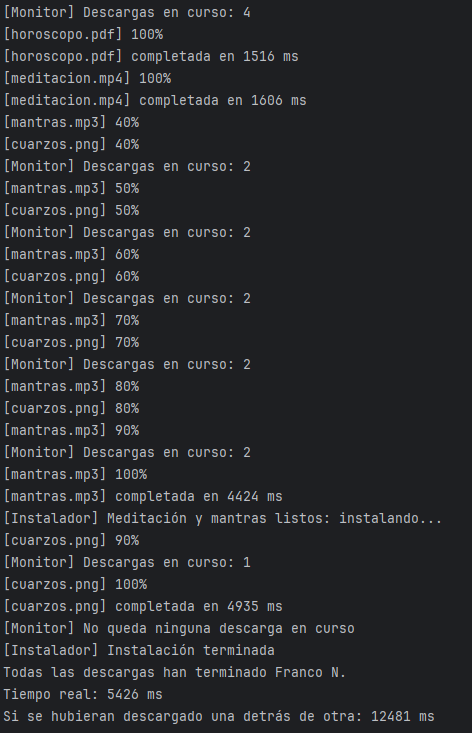
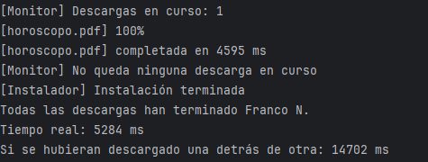
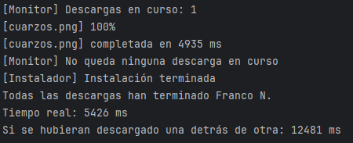

# Tarea 09 - Descargas Cuánticas

Franco Naraza

## Niveles realizados

Se han implementado los **3 niveles**:

-  Nivel 1 (obligatorio) — descargas simultáneas en hilos, informe final con tiempo real y suma.
-  Nivel 2 — nombres de archivo por línea de comandos + clase `Monitor` (`Runnable`).
-  Nivel 3 — clase `Instalador` (`Runnable`) que espera a `meditacion.mp4` y `mantras.mp3`, y espera con límite de 3 s en el `main`.

## Clases

- `Descarga` (hereda de `Thread`): simula la descarga de un archivo en 10 bloques, cada uno de entre 100 y 500 ms, e imprime el progreso. Guarda el tiempo total en un atributo con su getter.
- `Monitor` (implementa `Runnable`): cada 500 ms imprime cuántas descargas siguen vivas. Termina solo cuando no queda ninguna.
- `Instalador` (implementa `Runnable`): espera (con `join`) a que terminen `meditacion.mp4` y `mantras.mp3`, y después simula la instalación.
- `GestorDescargas`: tiene el `main`. Crea las descargas, las arranca todas, lanza el Monitor y el Instalador, y al final da el informe.

## Cómo se ejecuta

```bash
javac Descarga.java Monitor.java Instalador.java GestorDescargas.java
java GestorDescargas
```

También se puede indicar qué archivos descargar por línea de comandos (nivel 2):

```bash
java GestorDescargas cuarzos.png meditacion.mp4 mantras.mp3 horoscopo.pdf
```

Si no se pasa ningún archivo, se usan los 4 de por defecto.

## Salida de ejemplo

```text
[cuarzos.png] 10%
[meditacion.mp4] 10%
[Monitor] Descargas en curso: 4
[horoscopo.pdf] 10%
[mantras.mp3] 10%
[cuarzos.png] 20%
...
[horoscopo.pdf] completada en 1420 ms
[Monitor] Descargas en curso: 3
...
[mantras.mp3] completada en 2890 ms
[Instalador] Meditación y mantras listos: instalando...
[cuarzos.png] completada en 3210 ms
[Monitor] Descargas en curso: 1
[meditacion.mp4] completada en 4380 ms
[Monitor] No queda ninguna descarga en curso
[Instalador] Instalación terminada
Todas las descargas han terminado.
Tiempo real: 4390 ms
Si se hubieran descargado una detrás de otra: 11900 ms
```


## Captura de terminal




## Tabla de pruebas (Nivel 1)

| Ejecución | Descarga más lenta | Tiempo real (ms) | Suma (ms) |
| --- |--------------------|------------------|-----------|
| 1 | `mantras.mp3`      | 5025             | 11530     |
| 2 | `horoscopo.pdf`    | 5284             | 14702     |
| 3 | `cuarzos.png`      | 5426             | 12481     |

- ## E1:


- ## E2:

- ## E3:


### Preguntas

**¿Por qué el tiempo real es mucho menor que la suma?**

Porque las 4 descargas se ejecutan en paralelo, cada una en su propio hilo. Mientras un hilo está "durmiendo" (`Thread.sleep`), el planificador puede ejecutar a la vez los demás hilos, así que todas avanzan a la vez en lugar de esperar turno. Por eso el tiempo real se acerca al de la descarga más lenta, y no a la suma de todas.

**¿Qué pasa si hacéis `start()` y `join()` dentro del mismo bucle?**

Si en el mismo bucle se hace `d.start(); d.join();` para cada descarga, el hilo principal arranca una descarga y se queda bloqueado esperando a que termine antes de arrancar la siguiente. En la práctica, aunque se usen hilos, las descargas se ejecutan en serie, una detrás de otra, y el tiempo real sale prácticamente igual que la suma (en nuestras pruebas, unos 11900 ms en vez de 4390 ms).

## Declaración de uso de IA

**Herramienta usada:** Claude

**Prompt:**

> Hola Claude, tengo una duda con mi programa de descargas en hilos. En el `main` de `GestorDescargas` tengo esto:
>
> ```java
> meditacion.join(3000);
> if (meditacion.isAlive()) {
>     System.out.println("[Main] meditacion.mp4 sigue en segundo plano");
> }
> ```
>
> No entiendo bien qué hace exactamente `join(3000)`. ¿El hilo de `meditacion.mp4` se para a los 3 segundos si no ha terminado? ¿Por qué después tengo que comprobar `isAlive()`? Y si el hilo sigue vivo después de esos 3 segundos, ¿qué pasa con él, se queda descargando igualmente en segundo plano o se pierde? Tampoco entiendo muy bien por qué luego, más abajo en el código, hay otro bucle que hace `d.join()` (sin número) sobre todas las descargas, incluida `meditacion.mp4` otra vez. ¿No es raro hacer `join` dos veces sobre el mismo hilo?

**Para qué la usé:** para entender el funcionamiento de `join(timeout)` en el nivel 3 (la espera con límite de 3 segundos sobre `meditacion.mp4`).

**Qué aprendí / cambié:** entendí que `join(3000)` solo hace que el hilo que llama (el `main`) espere como mucho 3 segundos a que `meditacion.mp4` termine, pero **no detiene ni cancela** el hilo de la descarga. Si pasados esos 3 segundos sigue viva, `isAlive()` lo detecta y el programa simplemente avisa por consola, sin matarla; por eso sigue "en segundo plano" descargando con normalidad. También entendí por qué el segundo `join()` sin límite, más abajo en el código, no es redundante: ese es el que de verdad garantiza que el programa no termine ni imprima el informe final hasta que `meditacion.mp4` (y el resto de descargas) hayan acabado del todo, aunque antes ya se hubiera avisado de que iba lenta.